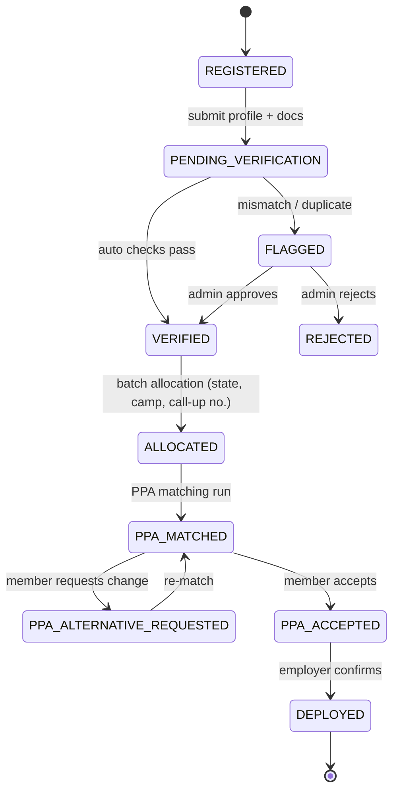

# NAPS — NYSC Automated Posting System
### Project Understanding & Build Blueprint (Next.js + Firebase)

> **Source:** `james chapter one (1) (3).docx` — *"Development and Automate NYSC Posting System"*, Ogamu Iduyukpo Ibrahim (FT22BCMP0750), B.Sc. Computer Science, Nasarawa State University, Keffi. Supervisor: Prof. Uche M. Mbanaso. June 2026.
>
> **Target stack (changed from the document):** Next.js (App Router, TypeScript) + Firebase (Auth, Firestore, Storage). Chapter 3 names PHP/Laravel or Django with MySQL/PostgreSQL. Section 9 shows how each part of that design maps to the new stack.


---

## PART A — UNDERSTANDING THE PROJECT

### 1. The project in one paragraph
The NYSC (National Youth Service Corps, set up in 1973) sends every Nigerian graduate under 30 to serve for one year in a state other than their own. The way corps members are currently posted is partly digital, split across disconnected parts, open to manipulation, and blind to security risks. About 600,000 people graduate each year, but only 240k–350k are mobilised, and more than 500,000 were waiting by 2025. The project proposes **NAPS**: one web platform that covers **registration → verification → smart allocation (state + camp) → PPA (Place of Primary Assignment) matching → tracking & notifications → audit**. Allocation uses a **multi-criteria decision-making (MCDM)** engine. AHP sets the weights and TOPSIS ranks the options. The engine combines preferences, course of study, security risk, state-of-origin rules and capacity. No one can manually override it, and every decision is logged.

### 2. Problems the system must solve (from Ch. 1 & 3.3.2)
| # | Problem | How NAPS answers it |
|---|---------|------------------|
| 1 | **Technical inadequacy**: portal crashes, failed uploads, no scalability | Cloud-hosted, serverless, scalable stack |
| 2 | **Opaque, manipulable allocation**: bribes, home-state postings, ghost corps members | Algorithmic allocation, hard rules, **no manual override**, full audit trail |
| 3 | **No security awareness**: kidnappings in Zamfara/Delta, a murder in Kaduna | Security Risk Module; Critical states excluded unless the member opts in |
| 4 | **Career mismatch**: postings unrelated to the course, non-existent PPAs | Skills-based PPA matching; employers register real vacancies |
| 5 | **Fragmented data**: late senate lists, slow verification of foreign-trained graduates | Institution portal for uploading senate lists plus automatic cross-checking |

| 6 | **Camp overcrowding** | Capacity is a criterion and a hard limit in the allocation |

### 3. Objectives → system features (Section 1.3)
| Objective | Feature to build |
|-----------|------------------|
| O1 Analyse the current process | *(Research write-up, not code)* |
| O2 Central web platform | Next.js app with role-based portals |
| O3 Intelligent allocation algorithm | AHP + TOPSIS allocation engine |
| O4 Secure validation & identity checks | Verification module (senate list + mock NIMC check, age, duplicates) |
| O5 Real-time tracking, notifications, dashboards | Status timeline, in-app and email notifications, dashboards per role |
| O6 Security risk assessment | Security agency portal, risk levels per state, opt-in consent, briefings |
| O7 Skills-based matching | PPA matching engine, employer portal, accept / request alternative |
| O8 Evaluation (functional, load, security, usability) | Unit tests for the algorithm, k6/JMeter load scripts, Firestore rules tests, SUS questionnaire |

### 4. Scope
**In scope:** registration, verification, allocation of state, camp and call-up number, PPA matching, tracking, notifications, security risk, audit, reports, dashboards, and Batches A/B/C with Streams I/II. Covers university, polytechnic, college of education and foreign-trained graduates, plus professional categories (medical, education, engineering…).

**Out of scope:** running the camps (accommodation, feeding), CDS, SAED, allowance payments (Remita), passing out, and job placement after service.

**Data:** **simulated** data only, never real corps member records (Ethics section).

### 5. Actors (Use Case, Section 3.3.3)
| Role | Main actions |
|------|-------------|
| **Prospective Corps Member (PCM)** | Register, verify identity, pick 4 preferred states, give risk consent, track status, download call-up letter, accept or decline a PPA |
| **NYSC Administrator (HQ)** | Configure AHP weights and batches, run allocation, monitor, handle flagged cases, reports, audit |
| **Institution Official** | Upload senate (graduate) list, confirm credentials |
| **Employer (PPA)** | Register organisation and vacancies, review matches, confirm placements |
| **Security Agency** | Update risk level and incidents per state (and LGA) |
| *(Optional)* **Auditor** | Read-only access to audit logs and allocation explanations |

### 6. The allocation algorithm (core innovation)
Weights from the document:

| Criterion | Weight | Type | How it is computed (our interpretation) |
|-----------|--------|------|----------------------------------|
| Security Risk | **30%** | benefit (safer = higher) | Low=1.0, Moderate=0.66, High=0.33, Critical=0 *(Critical is filtered out unless consent given)* |
| Course Alignment | **25%** | benefit | Unfilled PPA vacancies in state *s* for the member's course category ÷ the highest such number across states |
| Preference | **20%** | benefit | 1st choice=1.0, 2nd=0.75, 3rd=0.5, 4th=0.25, not listed=0 |
| State-of-Origin Exclusion | **15%** | benefit | ⚠️ See note below. Proposal: **national integration score**: different geopolitical zone=1.0, same zone=0.5 |
| Infrastructure Capacity | **10%** | benefit | Free camp places ÷ total camp capacity in the state |

> [!WARNING]
> **Inconsistency in the document:** state of origin is described as an *absolute* exclusion ("no manual override") yet it also has a 15% weight. If it is a hard filter, every remaining state scores the same on it, so the weight changes nothing. Recommended fix: keep the hard filter, and use the 15% for **geopolitical-zone diversity**. That supports the national unity goal and gives the criterion a real effect.

**Pipeline per batch run:**
```
1. Pull all VERIFIED corps members for batch/stream (not yet allocated)
2. Generate a random seed → seeded shuffle of the queue (fairness + reproducibility); store the seed in the audit log
3. For each corps member:
   a. Candidate states = 37 (36 + FCT)
      − state of origin                         (HARD)
      − Critical-risk states unless riskConsent  (HARD)
      − states whose camp is full               (HARD)
   b. Build the decision matrix [candidates × 5 criteria]
   c. TOPSIS: vector-normalise → apply AHP weights → ideal/anti-ideal → closeness Ci
   d. Pick the state with the highest Ci; reserve a camp slot (Firestore transaction)
   e. Assign camp (1 per state), generate a call-up number, write the deployment record
   f. Write an audit log: inputs, matrix, weights, Ci for every candidate, chosen state, seed
4. Notify everyone; show summary statistics
```
**AHP:** the admin fills in a 5×5 pairwise comparison matrix (Saaty 1–9 scale). The system computes the weights (normalised principal eigenvector, or the geometric-mean approximation) and the **Consistency Ratio**. The weights are only saved if CR < 0.10. The default matrix reproduces 30/25/20/15/10.

**PPA matching (after camp):**
`score = 0.5·disciplineMatch + 0.2·LGA safety + 0.2·employer-preferred qualifications + 0.1·remaining-capacity ratio`.
Greedy assignment by score with capacity limits. The member can **accept** or **request an alternative** (justification required, max 1). Employers **confirm**.

### 7. Lifecycle of a corps member (status machine)


### 8. Non-functional requirements (Section 3.3.3), adjusted to be realistic for a prototype
| NFR | Document target | Prototype implementation |
|-----|-----------------|--------------------------|
| Scalability | 100k+ concurrent users | Vercel + Firestore (serverless). Demonstrate with a k6 load test (e.g. 1k–5k virtual users) |
| Security | TLS, RBAC, 2FA, XSS/SQLi protection | HTTPS (Vercel), Firebase custom claims (RBAC), Firestore rules, optional TOTP/SMS MFA, zod validation, no SQL (NoSQL) |
| Reliability | 99.9% uptime | Managed Firebase/Vercel SLAs, Firestore backups (export) |
| Usability | Accessible, low bandwidth | Tailwind + shadcn/ui (accessible Radix base), responsive, light pages |
| Interoperability | REST APIs to NIMC, JAMB, Remita… | Next.js Route Handlers as a REST API. **NIMC/JAMB are mocked** with seeded collections |
| Multilingual | English, Hausa, Yoruba, Igbo | `next-intl`, English first, other languages *optional / stretch* |

> [!NOTE]
> **Issues found in the document itself** (worth fixing before submission):
> 1. The **Abstract describes a different project** ("AgriPrice-NG", agricultural price prediction). It needs rewriting for NAPS.
> 2. The **List of Figures** also refers to AgriPrice-NG figures.
> 3. Title typo: "AUTOMETE" → "AUTOMATED".
> 4. The references are duplicated, and some cited works (Munir et al., Yamamoto, Alharbi et al.) are missing from the list.
> 5. The weights clash with the state-of-origin rule (explained in Section 6).
> 6. Chapter 3 names Laravel/Django + MySQL; Chapter 4 should describe Next.js + Firebase instead.

---

## PART B — DECONSTRUCTION (BUILD-READY)

### 9. Mapping the document's design onto Next.js + Firebase
| Document (3-tier) | Our implementation |
|---------------------|--------------------|
| Presentation tier (React) | Next.js App Router + React Server Components, Tailwind, shadcn/ui |
| Application tier (Laravel/Django) | Next.js **Route Handlers / Server Actions** using the **Firebase Admin SDK** (allocation runs only on the server) |
| Data tier (MySQL/PostgreSQL) | **Cloud Firestore** (NoSQL); ERD entities become collections |
| Auth / RBAC | **Firebase Auth** + **custom claims** `{ role }` + Firestore Security Rules |
| File / biometric upload | **Firebase Storage** (passport photo, certificate, consent form) |
| Notifications | Firestore `notifications` collection (real-time in-app) + email via **Resend/Nodemailer**. SMS is mocked/logged |
| Cron (weekly risk refresh) | Vercel Cron → Route Handler *(optional)* |

> [!TIP]
> Run privileged logic (allocation, verification, call-up generation) in **Next.js server routes with the Admin SDK**, not in Cloud Functions. The project then fits the **free Spark plan**, because Cloud Functions require the Blaze plan.

### 10. Tech stack & packages
- **Framework:** `next@15`, `react@19`, `typescript`
- **UI:** `tailwindcss`, `shadcn/ui`, `lucide-react`, `recharts` (charts), `sonner` (toasts)
- **Forms/validation:** `react-hook-form`, `zod`, `@hookform/resolvers`
- **Firebase:** `firebase` (client), `firebase-admin` (server)
- **Session:** Firebase ID token → httpOnly session cookie (`admin.auth().createSessionCookie`) + `middleware.ts` route guard
- **CSV:** `papaparse` (senate lists, PPA vacancy bulk upload)
- **PDF:** `@react-pdf/renderer` (call-up letter, posting letter) + `qrcode` (QR to verify a letter)
- **Email:** `resend` (or `nodemailer`)
- **Testing:** `vitest` (algorithm), `@firebase/rules-unit-testing` (rules), `k6` (load)
- **Dev:** Firebase Emulator Suite, `tsx` for seed scripts

### 11. Firestore data model (from the ERD in Section 3.3.3)

```
users/{uid}
  role: 'corps_member'|'admin'|'institution'|'employer'|'security'|'auditor'
  email, displayName, orgId?, createdAt

corpsMembers/{uid}
  nin, matricNo, institutionId, surname, firstName, otherNames, gender,
  dob, stateOfOrigin, phone, course, courseCategory, qualification,
  classOfDegree, graduationYear, isForeignTrained, batchId, stream,
  preferences: [s1,s2,s3,s4], riskConsent: bool, riskConsentAt?,
  photoUrl, certificateUrl,
  status: <status machine>, flags: string[],
  allocation?: { stateCode, campId, callUpNo, score, allocatedAt, runId },
  ppa?: { ppaId, vacancyId, score, matchedAt, acceptedAt?, altRequest? }

institutions/{id}       name, code, type(university|polytechnic|coe|foreign), accredited, state
senateLists/{id}        institutionId, matricNo, fullName, dob, course, graduationYear, class, uploadedAt, used:bool
nimcRecords/{nin}       (MOCK) fullName, dob, gender, stateOfOrigin, photoUrl

states/{code}           name, zone(NC|NE|NW|SE|SS|SW), riskLevel, riskScore,
                        incidentCount, lastUpdated, updatedBy
states/{code}/lgas/{id} name, riskLevel
camps/{id}              stateCode, name, address, capacity, occupied, batchId

employers/{id}          name, sector, stateCode, lga, address, verified, contact
vacancies/{id}          employerId, stateCode, lga, title, courseCategories[], preferredQualifications[],
                        capacity, filled, batchId

securityIncidents/{id}  stateCode, lga, type(kidnapping|banditry|terrorism|communal|accident),
                        severity, date, description, reportedBy

batches/{id}            name ("2026 Batch A"), stream, mobilizationDate, maxAge(30),
                        status(open|verification|allocating|allocated|ppa|closed)
config/allocation       weights{security,course,preference,integration,capacity}, ahpMatrix[5][5], cr, updatedBy
allocationRuns/{runId}  batchId, seed, weights, startedBy, startedAt, finishedAt, totals, stats
auditLogs/{id}          action, actorUid, actorRole, targetType, targetId, details(map), runId?, timestamp
                        → explanations per decision: { candidates:[{state,criteria,ci}], chosen }
notifications/{id}      uid, title, body, type, read, createdAt
courseCategories/{id}   name (Medical, Education, Engineering, Law, Agric, Science, ICT, Business, Arts, SocialSci), courses[]
counters/{key}          callUp sequence per institution/batch
```
**Indexes:** `corpsMembers(batchId,status)`, `vacancies(stateCode,batchId)`, `auditLogs(targetId,timestamp)`, `notifications(uid,createdAt)`.

### 12. Security rules (summary)
- `auditLogs`, `allocationRuns`, `corpsMembers.allocation/ppa/status`: **writes only through the Admin SDK** (`allow write: if false` for clients). This is the code-level "no manual override" guarantee.
- Corps member: read/update **their own** document only while status is `REGISTERED`, and only profile fields.
- Institution: create/read `senateLists` where `institutionId == token.orgId`.
- Employer: CRUD its own `vacancies`; read matched members' basic details.
- Security: write `states.riskLevel`, `securityIncidents`.
- Admin/Auditor: read everything. Admin writes `config`, `batches`, `camps`.

### 13. Verification module (Objective 4): automatic checks
| Check | Rule | On failure |
|-------|------|-----------|
| Senate list match | `matricNo + institutionId` exists in `senateLists`, not already used | FLAG `NOT_ON_SENATE_LIST` |
| Identity (mock NIMC) | NIN exists; name (fuzzy ≥ 0.85) + DOB match | FLAG `NIN_MISMATCH` |
| Age | Age at `batch.mobilizationDate` ≤ 30 | REJECT `OVER_AGE` *(or exempt category)* |
| Duplicate | NIN / matricNo / email / phone unique | FLAG `DUPLICATE` |
| State of origin | Matches NIMC record | FLAG `SOO_MISMATCH` |
| Foreign-trained | Always routed to manual review | FLAG `FOREIGN_REVIEW` |
| Documents | Photo + certificate uploaded | Block submission |

Members who pass every check → `VERIFIED` straight away. Members with a flag → admin "Exceptions" queue, where the admin must enter a reason, which is audited.

### 14. Pages / routes
```
/                               Landing (about, how it works, transparency stats)
/login  /register               Auth (corps member self-register; other roles invited by admin)

/member/dashboard               Status timeline, notifications
/member/profile                 Bio-data, NIN, matric, course, uploads
/member/preferences             4 preferred states (origin hidden, risk badge shown, consent dialog for Critical)
/member/allocation              State, camp, call-up no., security briefing, "Why this state?" explanation
/member/ppa                     Matched PPA, accept / request alternative
/member/letters                 Download call-up & posting letter (PDF + QR)

/admin/dashboard                KPIs, charts (by state, zone, course, status)
/admin/batches                  Create/open/close batches & streams
/admin/verification             Exceptions queue (flagged)
/admin/allocation               AHP matrix editor + CR, run allocation (dry-run preview + commit)
/admin/ppa-matching             Run PPA matching, unmatched list
/admin/states  /admin/camps     Read state data, edit camp capacity
/admin/users                    Invite institution/employer/security users
/admin/reports                  Allocation reports, equity metrics, CSV/PDF export
/admin/audit                    Search audit logs, decision explanations

/institution/dashboard          Upload stats
/institution/senate-list        CSV upload + validation preview + history

/employer/dashboard             Organisation profile
/employer/vacancies             CRUD vacancies (course categories, capacity, LGA)
/employer/placements            Matched corps members → confirm/decline

/security/dashboard             Nigeria risk map/table
/security/states                Update risk levels (state & LGA)
/security/incidents             Log incidents

/verify/[callUpNo]              Public letter verification (QR target)

API (Route Handlers, server-only, Admin SDK):
POST /api/auth/session                 create/destroy session cookie
POST /api/members/submit               runs verification
POST /api/admin/verification/[uid]     approve/reject flagged
POST /api/admin/ahp                    compute weights + CR, save config
POST /api/admin/allocation/run         { batchId, dryRun }
POST /api/admin/ppa/run                { batchId }
POST /api/member/ppa/respond           accept | alternative
POST /api/employer/placements/confirm
POST /api/institution/senate-list      CSV → validated docs
GET  /api/letters/callup/[uid]         PDF
GET  /api/reports/[type]               CSV
```

### 15. Project structure
```
naps/
├─ app/
│  ├─ (public)/page.tsx, login/, register/, verify/[callUpNo]/
│  ├─ member/ … admin/ … institution/ … employer/ … security/
│  └─ api/ …
├─ components/  ui/ (shadcn), layout/ (Sidebar, Topbar), charts/, forms/, StatusTimeline, RiskBadge, ExplainAllocation
├─ lib/
│  ├─ firebase/  client.ts, admin.ts, session.ts
│  ├─ algorithms/  ahp.ts, topsis.ts, allocation.ts, ppaMatching.ts, seededRandom.ts
│  ├─ verification/  checks.ts, fuzzy.ts
│  ├─ services/  audit.ts, notify.ts, callup.ts, pdf/
│  ├─ validation/  zod schemas
│  └─ constants/  states.ts (37 + zones), courses.ts, riskLevels.ts
├─ middleware.ts                   role-based route guard
├─ scripts/  seed.ts               states, camps, institutions, nimc mock, senate lists, employers, vacancies, ~1–5k members
├─ tests/  ahp.test.ts, topsis.test.ts, allocation.test.ts, verification.test.ts, rules.test.ts
├─ load/  k6-registration.js, k6-allocation.js
├─ firestore.rules  firestore.indexes.json  storage.rules  firebase.json
└─ .env.local.example
```

### 16. Seed / simulated data
- **37 states** with zones, an initial risk level (e.g. Zamfara, Borno = Critical; Kaduna, Katsina = High; …), and 1 camp each with realistic capacity (e.g. 1,500–3,000).
- **~20 institutions** (mix of types, plus 1–2 foreign).
- **Mock NIMC records + senate lists** for ~2,000 graduates, with deliberate bad records (over-age, duplicates, NIN mismatches, not on the list) to show verification working.
- **~150 employers / ~400 vacancies** across states and course categories.
- **~30 security incidents.**
- Demo accounts: one per role.

### 17. Build order (one-pass plan)
| Phase | Deliverable | Depends on |
|-------|-------------|-----------|
| **0. Scaffold** | Next.js + TS + Tailwind + shadcn, Firebase project/emulators, env, folder structure | — |
| **1. Auth & RBAC** | Firebase Auth, session cookie, custom claims, `middleware.ts`, role layouts/sidebars, admin invites | 0 |
| **2. Data & seed** | Constants, zod schemas, Firestore rules/indexes, `seed.ts` | 1 |
| **3. Institution portal** | Senate list CSV upload + validation | 2 |
| **4. Member registration + verification** | Profile, uploads, preferences, consent, `/api/members/submit` checks, status timeline | 2, 3 |
| **5. Security portal** | Risk levels, incidents, risk table/map | 2 |
| **6. Admin core** | Batches, camps, exceptions queue, users | 4 |
| **7. Allocation engine** ⭐ | `ahp.ts`, `topsis.ts`, `allocation.ts` + unit tests, AHP editor UI, dry-run/commit, call-up numbers, audit explanations | 4, 5, 6 |
| **8. Employer portal + PPA matching** | Vacancies, `ppaMatching.ts`, accept/alternative, employer confirm | 7 |
| **9. Notifications & letters** | In-app + email, PDF letters with QR, `/verify` page | 7, 8 |
| **10. Dashboards, reports & audit** | Charts, equity metrics, CSV export, audit search, auditor role | 7, 8 |
| **11. Hardening & evaluation** | Rules tests, k6 scripts, (optional) MFA, i18n, landing page, deploy to Vercel | all |

### 18. Mapping to evaluation (Ch. 3.4 → Ch. 4/5 of the write-up)
- **Functional testing:** Vitest suites (AHP CR, TOPSIS ranking, hard constraints never broken: 0 members posted to their state of origin, 0 posted to Critical states without consent, no camp over capacity).
- **Load testing:** k6 against the deployed app (registration + status reads). Allocation benchmark on 1k / 5k / 10k simulated members.
- **Security testing:** Firestore rules unit tests (a client cannot write an allocation), OWASP checklist.
- **Usability:** Nielsen heuristic checklist + SUS questionnaire.
- **Transparency metric:** every allocation has an audit record with a reproducible seed. Re-running with the same seed gives the same result.

---

## 19. Decisions
| # | Topic | Decision |
|---|-------|----------|
| 1 | State-of-origin 15% weight | ⏳ *Pending: see Section 20* |
| 2 | Email / SMS | ✅ **Brevo** transactional email API (free tier: 300 emails/day). SMS sent through Brevo SMS if credits exist, otherwise logged (mock) |
| 3 | 2FA | ✅ **Built for admin (and auditor) accounts**: app-based TOTP (Google Authenticator / Authy) with `otplib` + `qrcode`. Implemented server-side so it works on the **Spark plan** (Firebase's own MFA needs an Identity Platform upgrade). The session cookie is only issued after the TOTP code is checked. Includes 8 one-time backup codes, stored hashed |
| 4 | Multilingual | English first, `next-intl` wired up (other languages are a stretch goal) |
| 5 | Hosting | ✅ **Vercel (Hobby) + Firebase Spark (free)**. No Cloud Functions; privileged logic runs in Next.js route handlers with the Admin SDK |
| 6 | Map | ✅ **OpenStreetMap** via `leaflet` + `react-leaflet` (loaded client-side only). Choropleth of a **Nigeria states GeoJSON** coloured by risk level, camp markers, incident markers, allocation density layer. Used on the security dashboard, admin dashboard, member preferences page and public landing page |

**Extra packages from these decisions:** `@getbrevo/brevo` (or a plain `fetch` to the Brevo REST API), `otplib`, `qrcode`, `bcryptjs` (backup codes), `leaflet`, `react-leaflet`, `public/geo/nigeria-states.geojson`.

**2FA flow (admin):** email/password → server checks the ID token → if `role ∈ {admin, auditor}` and 2FA is enabled, store a short-lived `pending_2fa` cookie → `/2fa` page → `POST /api/auth/2fa/verify` → full session cookie. First login forces enrolment at `/2fa/setup` (QR code + confirm code). The `mfaVerified` flag is checked in `middleware.ts` for every `/admin/*` route.
